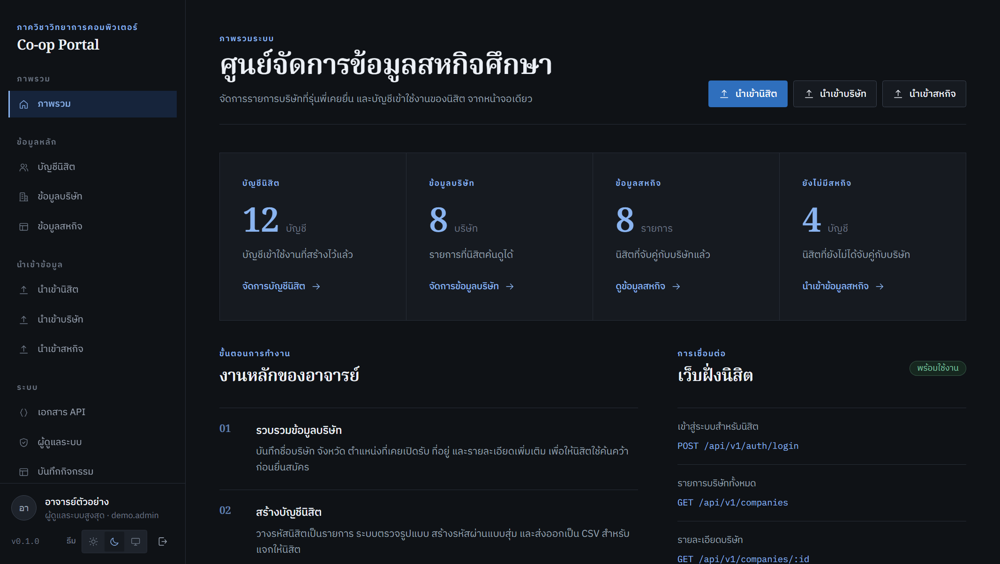
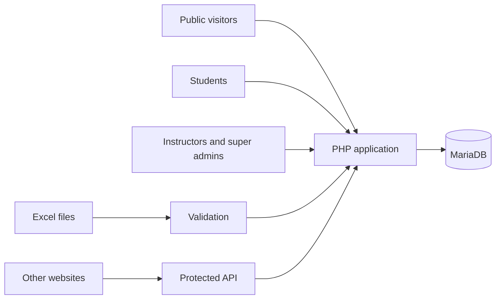
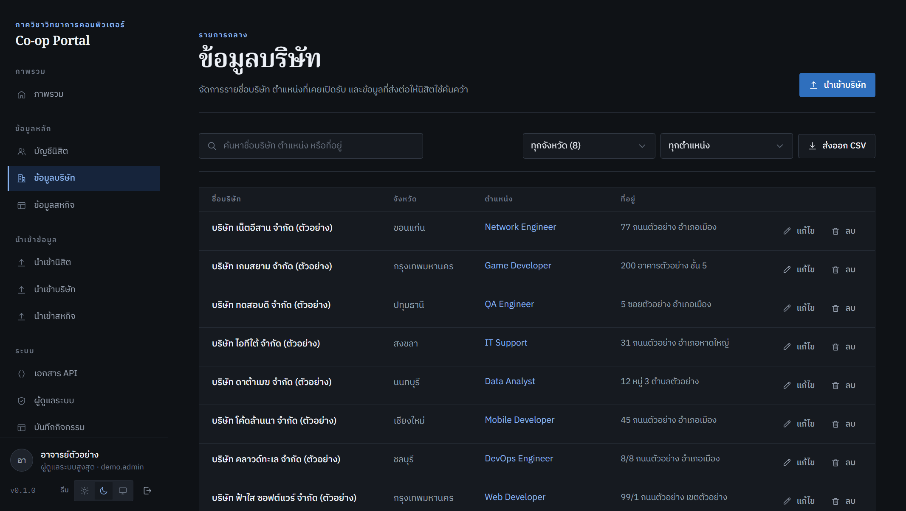
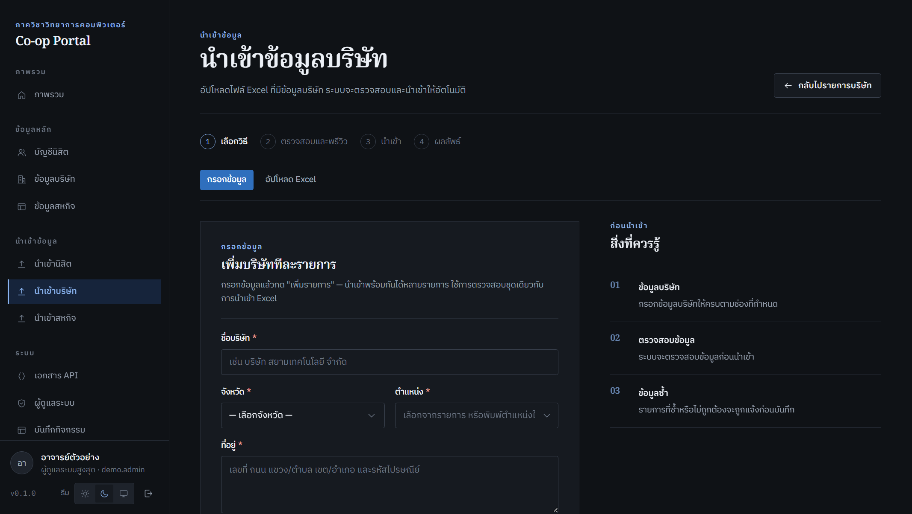
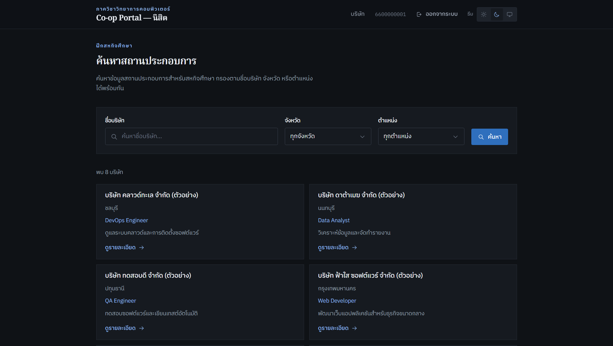
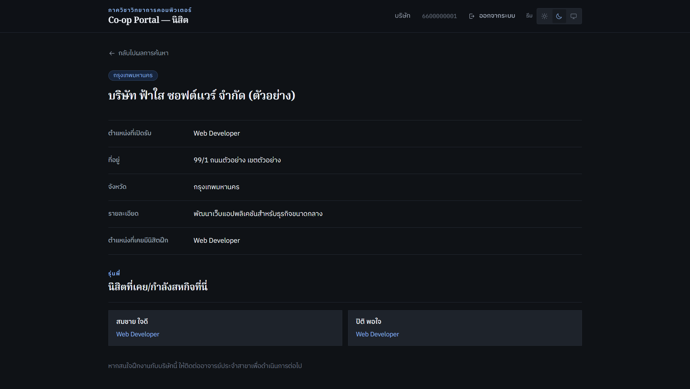

# CS-Coop
Showcase of CS-Coop, a cooperative education management system built with PHP 8.2 and MariaDB.

A system for managing students, companies, and co-op placements in a Computer Science department.

> This repository is a project showcase. It holds a project summary and screenshots only. The full source code is private.
>
> All images use sample data, not real student or company information.

## Overview

Instructors manage students, companies, and co-op records in one place. Students can search companies and see the positions past students held. The public can search companies without logging in.

**Role:** Full-stack Developer. I built on a back-office system started by a senior student and developed the rest of the latest version, about 80–90% of the system.

**Status:** Deployed and waiting for the department to import its data.

**Live site:** [Public company search](https://cscoop.comsciproject.net/public/search). The site is waiting for its data, so the list may be empty.

## The challenge

The system was built with Next.js, React, and Prisma, but it had to move to hosting that accepts files over FTP, without Node.js or Composer.

## What I built

- Rebuilt the system in PHP 8.2 and MariaDB
- Data import through manual entry and Excel upload, with validation before saving
- A custom `.xlsx` reader, because Composer was not available
- Filters, CSV export, and delete confirmation
- Separate public, student, instructor, and super admin access, with activity logs
- An API for connecting with other websites
- Deployment, handover documents, and a user guide

## Access by role

| What each role can do | Public | Student | Instructor | Super admin |
|---|:---:|:---:|:---:|:---:|
| Search companies | Yes | Yes | Yes | Yes |
| See positions past students held | – | Yes | Yes | Yes |
| Manage companies, students, and co-op records | – | – | Yes | Yes |
| Import data from Excel and export CSV | – | – | Yes | Yes |
| Manage instructor accounts | – | – | – | Yes |
| View activity logs | – | – | – | Yes |

## System overview

## Hardest part

The automated tests all passed, but real HTTP testing showed that students could not log in and every Excel upload failed.

- **Student login:** two values were saved in the wrong order, so a student session could never be validated.
- **Excel upload:** the file extension was checked on PHP's temporary file name, which has no `.xlsx` extension.

I traced both causes, fixed them, and retested them over HTTP.

## Screenshots

| Companies | Data import |
|---|---|
|  |  |

| Student search | Company details |
|---|---|
|  |  |

## Tech

PHP 8.2, MariaDB, PDO, JavaScript, Hostinger

---

© All rights reserved. The images here may not be reused without permission.
